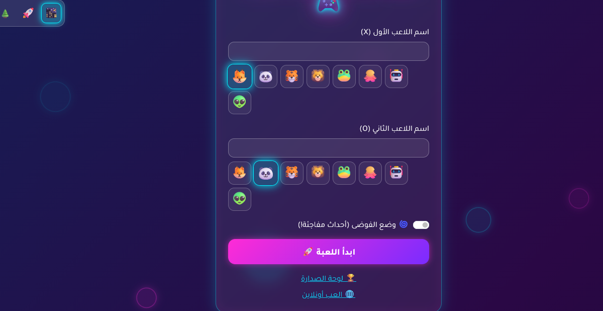
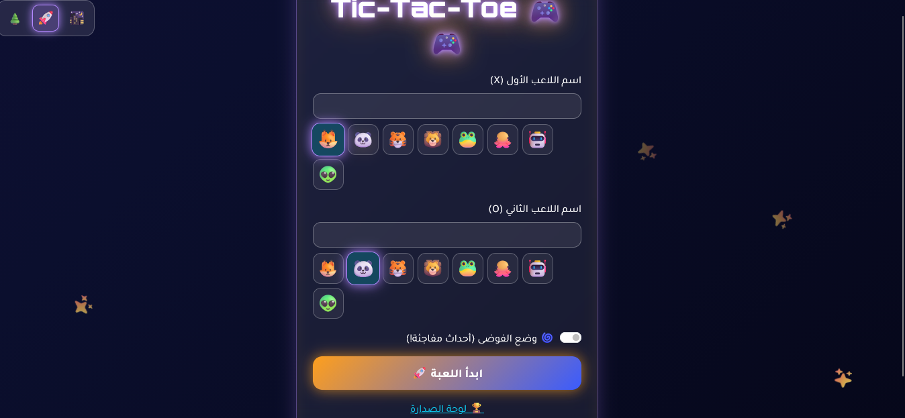
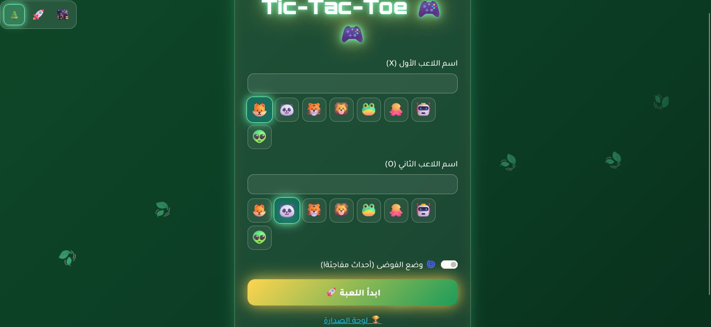
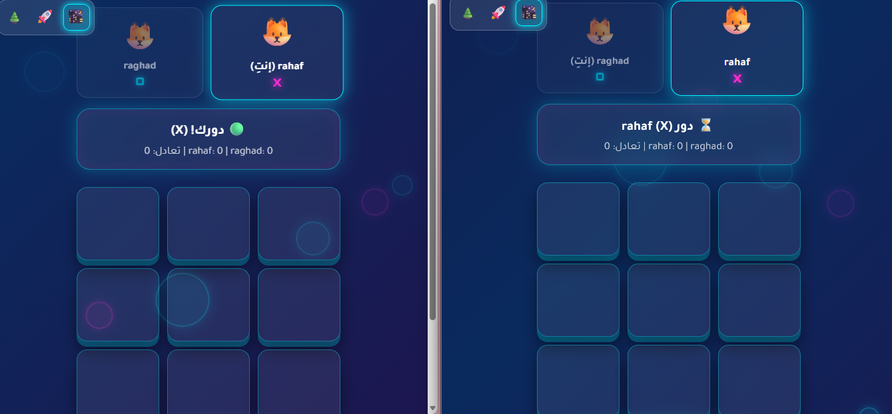
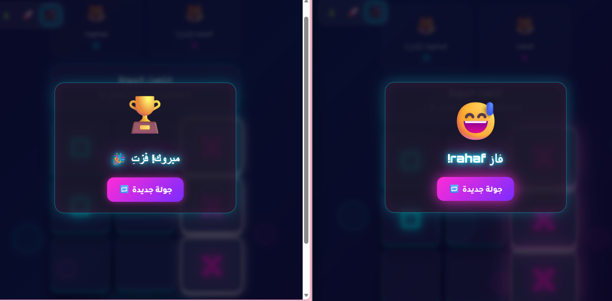

# 🎮 Tic-Tac-Toe Web

A real-time Tic-Tac-Toe web game built with **PHP, MySQL, JavaScript, and Bootstrap**, with a focus on secure development practices.

## ✨ Features

- **Local multiplayer** on one device, with avatars and a score board
- **Online multiplayer**: create a room, share the 5-character code, and play live from two devices
- **3 switchable themes**: Neon, Space, Forest (each with its own colors, background, and sounds)
- **3D animated board** that tilts with the mouse, plus sound effects and confetti
- **Chaos Mode**: random server-side events (locked cells, vanishing marks, double turns)
- **Round replay**: every finished round is stored and can be replayed move by move
- **Leaderboard** powered by MySQL

## 🔐 Security

- **CSRF protection** on forms and API requests using per-session tokens, verified with `hash_equals`
- **SQL injection prevention** with PDO prepared statements
- **XSS prevention** through output encoding (`htmlspecialchars`) and safe DOM updates (`textContent`)
- **Server-side authority**: the server decides whose turn it is and which moves are valid, so tampering from the browser console has no effect
- **Secure room codes** generated with `random_int`, and atomic database updates so two players cannot take the same slot
- **Input validation**: whitelists, length limits, and format checks
- **Session hardening**: session ID regeneration and per-room membership checks
- **No secrets in the repository**: `config/db.php` is git-ignored, and `config/db.example.php` is provided as a template

## 🧰 Tech Stack

PHP 8 · MySQL · JavaScript (vanilla) · Bootstrap 5 · CSS animations · Web Audio API

## 🚀 Getting Started

1. Install **WampServer** (or XAMPP) and start Apache and MySQL.
2. Copy this project into the web root, for example `C:\wamp64\www\tictactoe`.
3. Open **phpMyAdmin**, go to the **Import** tab, and import `database.sql`.
4. Copy `config/db.example.php` to `config/db.php` and adjust the credentials if needed.
5. Open `http://localhost/tictactoe/` in your browser.

For online play, open the game in two different browsers (or one normal window and one private window) so each player has a separate session.

## 📁 Project Structure

```
├── index.php          # Start page (local game setup)
├── game.php           # Local game
├── online.php         # Create / join an online room
├── room.php           # Online room
├── leaderboard.php    # Leaderboard
├── replay.php         # Round replay
├── api/               # JSON endpoints (moves, room state, reset)
├── classes/           # Board and Game logic
├── config/            # Database and CSRF helpers
├── css/ · js/         # Frontend assets
└── database.sql       # Database schema
```

## 📸 Screenshots

## 📸 Screenshots

### Themes

| Neon | Space | Forest |
|:---:|:---:|:---:|
|  |  |  |

### Online multiplayer

Two players in the same room, each on their own device, with live sync:



Round result shown to both players:



## 🔮 Planned improvements

- Security headers and cookie flags
- Rate limiting
- Player accounts